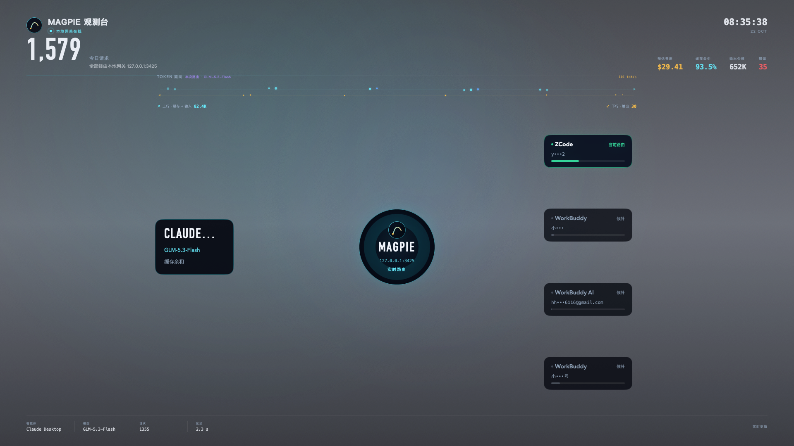
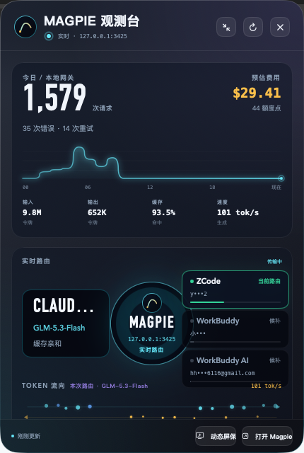

# MAGPIE 观测台（Magpie Watch）

一个只读取本机 Magpie 网关的 macOS 桌面观测应用：动态壁纸、悬浮小组件与全屏动态屏保三合一。它把今日用量、预估费用、token 流向、额度压力和真实路由链路，变成桌面上随时可见的实时画面。

> 这是社区驱动的非官方工具，与 Magpie 官方无隶属关系。界面名称仅用于标明数据来源。



## 功能

- **动态壁纸**：常驻在系统壁纸之上、桌面图标之下的透明图层。主舞台是多条智能体同时经过 Magpie 网关发往模型，响应再沿原路回流。没有真实路由时节点等待、链路为虚线。鼠标完全穿透。逐屏显示，显示器插拔自动重建。
- **悬浮小组件**：展开 `430 × 640` / 紧凑 `294 × 196` 两种尺寸，可置顶、拖动、鼠标穿透或隐藏；默认不显示，从菜单栏或偏好设置开启。
- **token 流向动画**：缓存与输入分成两股交织光带，输出反向回流。光带厚度、彗星数量和流速按真实 token 体量与生成速度缩放；体量为 0 的方向只留静止虚线。有路由数据时精确到**本次请求**，并标注所属模型。
- **四套视觉主题**：极光暮色、黑金夜宴、离子极昼、熔核。在菜单栏或偏好设置里切换，小组件、动态壁纸和屏保一起更换，选择会记住。
- **路由动画**：壁纸和屏保看多个智能体并发经过网关；小组件仍是单条 `智能体 → Magpie 网关 → 候选服务商/账号`。粒子只跟真实 trace 走。
- **全屏动态屏保**：空闲后自动进入，覆盖所有显示器，任意输入退出；显示期间阻止系统睡眠。
- **实时指标**：今日请求、预估费用、缓存命中、令牌、生成速度、错误、重路由、延迟、账号额度压力。
- **隐私优先**：只访问 `127.0.0.1:3425`，默认遮蔽邮箱账号；不上传数据、不截屏、不使用 OCR。

## 界面

| 动态壁纸 | 展开小组件 |
| --- | --- |
|  |  |

仓库里的截图仍是上一版极光暮色布局。多 agent 壁纸舞台和另外三套主题需要在 Mac 上重新截取。

## 系统要求

- macOS 14 Sonoma 或更高版本（Apple Silicon / Intel）。
- Xcode 16 或更高版本（提供 Swift 6 工具链）。
- 本机安装并运行 [Magpie](https://github.com/yetone/magpie)（默认网关 `http://127.0.0.1:3425`）。
- 项目没有第三方 Swift 依赖。

## 快速开始

### 从源码构建

```bash
git clone https://github.com/gzx543097079/magpie-watch.git
cd magpie-watch
./build-app.sh
open 'dist/Magpie Watch.app'
```

`build-app.sh` 会执行 release 构建、组装 `.app`、写入 Info.plist 并 ad-hoc 签名。如果你本机安装了 Magpie，脚本会尝试复用它的图标；没有也不会失败（应用会使用系统默认图标）。

### 从源码直接运行

```bash
swift build
.build/debug/MagpieWatch
```

开发启动参数：

```bash
.build/debug/MagpieWatch --expanded      # 展开小组件
.build/debug/MagpieWatch --compact       # 紧凑小组件
.build/debug/MagpieWatch --preferences   # 打开偏好设置
.build/debug/MagpieWatch --screensaver   # 直接进入屏保
.build/debug/MagpieWatch --wallpaper     # 开启动态壁纸
```

启动参数可以组合使用，例如 `--wallpaper --preferences`。

## 使用说明

1. 先启动 Magpie，确认网关监听 `127.0.0.1:3425`。
2. 启动 Magpie Watch 后只在菜单栏出现波形图标（不占 Dock）。
3. 菜单栏操作：
   - 显示/隐藏桌面小组件（⌘W）
   - 进入动态屏保（⌘S）
   - 显示/隐藏动态壁纸（⌘D）
   - 视觉主题（极光暮色 / 黑金夜宴 / 离子极昼 / 熔核）
   - 刷新数据（⌘R）
   - 重置小组件位置
   - 偏好设置（⌘,）
   - 打开 Magpie
4. 偏好设置中可切换视觉主题、小组件置顶、鼠标穿透、动态壁纸、空闲自动屏保（1–20 分钟）和邮箱遮蔽。

## Token 流向

「TOKEN 流向」把流量画成光带。颜色随主题变化，角色不变：

| 方向 | 内容 | 极光暮色中的颜色 |
| --- | --- | --- |
| 上行 → | 缓存读取 | 亮青 |
| 上行 → | 输入令牌 | 蓝 |
| ← 下行 | 输出令牌（响应） | 琥珀 |

- 光带厚度、彗星数量和流速按 token 体量（对数刻度）和生成速度缩放，10M token 达到最粗。
- 某一方向的 token 为 0 时，该车道只保留静止虚线，不会编造粒子。
- 有路由追踪数据时显示**本次请求**的真实用量，并标注「本次路由 · 模型名」；无数据时回退今日累计。
- 右上角显示今日平均生成速度（tok/s）。
- 小组件使用紧凑或面板光带。动态壁纸和屏保不再用光带当主画面，token 体量改由路由包的数量表示，底部只读本段真实上/下行。
- 「减少动态效果」开启时，彗星和流光停止，厚度和颜色仍表示用量。

## 视觉主题

| 主题 | 气质 |
| --- | --- |
| 极光暮色 | 原来的青紫夜色，琥珀回流 |
| 黑金夜宴 | 暖黑底，香槟缓存、银白输入、红宝石回流 |
| 离子极昼 | 冷墨底，冷白缓存、钴蓝输入、品红回流 |
| 熔核 | 炭红底，熔岩缓存、暖白输入、冷青回流 |

菜单栏「视觉主题」或偏好设置里的色板都可以切换。设置键是 `magpie.theme`，默认 `aurora`。

## 动态屏保说明

这是**应用内全屏动态屏保**，不是注册到 macOS「系统设置 → 屏幕保护程序」的原生 `.saver` 扩展。

- 空闲判断综合鼠标移动、点击、滚动和键盘事件；应用启动后的前 30 秒不会自动触发。
- 屏保显示期间会阻止系统空闲睡眠和显示器睡眠，但不会锁屏、不修改系统安全设置。
- 移动鼠标、点击、滚轮或按任意键即可退出。
- 「减少动态效果」（Reduce Motion）启用时，装饰性粒子动画会自动停用。

## 数据接口

应用只访问本机回环地址：

| 接口 | 用途 |
| --- | --- |
| `GET /` | 服务名称、版本、PID 等状态 |
| `GET /v1/magpie/usage?period=today` | 今日用量、费用、令牌、错误、趋势 |
| `GET /v1/magpie/quotas` | 服务商、账号、额度窗口与重置时间 |
| `GET /v1/magpie/trace?after=0` | 路由追踪、候选账号、每路由 token 用量 |

轮询间隔约 4 秒，单次请求超时 4 秒。接口不可用时显示离线状态并自动重试，已获得的数据保留展示。

## 隐私说明

- 不截屏、不使用 OCR、不读取 Magpie 的账号密码。
- 不上传用量、路由或账号信息到任何云端服务。
- 只请求本机 `127.0.0.1:3425` 的 Magpie API。
- 账号邮箱默认遮蔽，关闭遮蔽后原始账号也只在本机界面显示。

## 已知限制

- 不是系统级屏幕保护程序，无法在「系统设置 → 屏幕保护程序」中选择。
- 端口目前固定 `127.0.0.1:3425`，暂无设置界面（见 HANDOFF.md 的 P1 清单）。
- ad-hoc 签名，仅适合本机使用；跨机器分发需要 Developer ID 签名与公证。
- 应用图标若来自本机 Magpie，版权归 Magpie 项目所有，仅本机使用；分发时应替换为自有图标。
- 没有自动化 UI 测试；路由动画、屏保退出和多显示器以人工回归为主。

## 许可证

[MIT](LICENSE) © 2026 gzx543097079

Magpie 是 [yetone](https://github.com/yetone/magpie) 的项目；本工具与其无隶属关系，Magpie 名称与图标版权归原作者所有。

## 开发文档

字段约定、架构决策、窗口层级细节和维护注意事项见 [HANDOFF.md](HANDOFF.md)。
