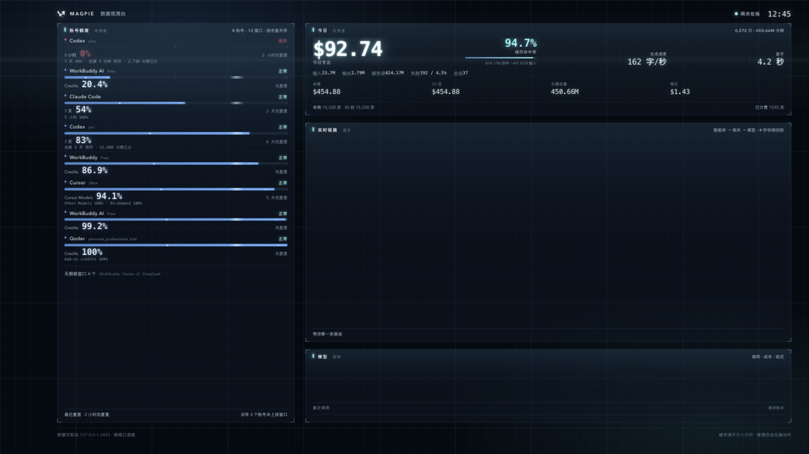

# MAGPIE 观测台（Magpie Watch）

一个把本机 Magpie 用量变成桌面壁纸的 macOS 桌面伴侣。壁纸是一块常驻桌面的数据观测台：账号额度、今日消耗、实时路由明细和智能体排行都直接读本机 Magpie。另有一个可选悬浮小组件和一个全屏屏保。

> 这是社区驱动的非官方工具，与 Magpie 官方无隶属关系。界面名称仅用于标明数据来源。



## 功能

- **桌面数据观测台**：壁纸是一块 HTML/CSS 数据面板，由本机 `127.0.0.1:3425` 同源页面渲染。左侧整列是每个账号的额度窗口（余量、重置时间、压力），右侧三段分别是今日消耗（支出、缓存命中率、DeepSeek 等价折算、最近三小时）、实时数据流（在途/中位耗时/首字中位/输出 tok/失败、单次耗时轨迹、模型与项目分布、最近路由明细）和智能体排行。鼠标完全穿透，位于桌面图标下方，逐屏显示；桌面态左右各让开 Dock 与一列文件夹，全屏时两边顶满。
- **消耗来源**：合并 Magpie 路由与今日最近 100 条请求账本，展示实际输入、缓存、输出及请求用途（如上下文压缩、记忆整理、标题生成）。桌面下方常驻最近三次调用；菜单栏「Token 消耗明细…」（本应用获得焦点时可按 ⌘T）打开独立分析窗口，可展开工具返回、文件/图片、工具定义、系统指令等上下文组成；它们含历史内容，是上下文占用，不与请求用量重复相加。
- **桌面常驻统计**：顶部显示配置账号的余额/剩余额度、缓存命中率、今日新输入/缓存读取/输出。当前订阅账号返回额度百分比；未提供金额时不推算余额。邮箱遵循遮蔽设置，离线/读取失败标记旧数据。
- **悬浮小组件**：展开 `430 × 640` / 紧凑 `294 × 196` 两种尺寸，可置顶、拖动、鼠标穿透或隐藏；默认不显示，从菜单栏或偏好设置开启。
- **小组件 token 光带**：缓存与输入分成两股交织光带，输出反向回流。光带厚度、彗星数量和流速按真实 token 体量与生成速度缩放；体量为 0 的方向只留静止虚线。有路由数据时精确到**本次请求**，并标注所属模型。
- **实时路由**：壁纸的实时数据流面板按 4 秒轮询 `/v1/magpie/trace`，把最近 60 条路由渲染成 KPI、耗时轨迹、分布条和明细表，失败项标红；小组件仍是单条 `智能体 → Magpie 网关 → 候选服务商/账号` 光带。
- **全屏动态屏保**：空闲后自动进入，覆盖所有显示器，任意输入退出；显示期间阻止系统睡眠。
- **实时指标**：今日请求、预估费用、缓存命中、令牌、生成速度、错误、重路由、延迟、账号额度压力。
- **隐私优先**：只访问 `127.0.0.1:3425`，默认遮蔽邮箱账号；不上传数据、不截屏、不使用 OCR。

## 界面

| 动态壁纸 | 展开小组件 |
| --- | --- |
|  |  |

壁纸截图使用明确标注的演示数据，便于公开展示且不会泄露本机用量。静态截图无法呈现全屏过渡与模块落位。

## 系统要求

- macOS 14 Sonoma 或更高版本（Apple Silicon / Intel）。
- Xcode 16 或更高版本（提供 Swift 6 工具链）。
- 本机安装并运行 [Magpie](https://github.com/yetone/magpie)（默认网关 `http://127.0.0.1:3425`）。
- 项目没有第三方 Swift 依赖；壁纸页面由本机同源服务提供，不加载任何 CDN 资源。

## 快速开始

### 从源码构建

```bash
git clone https://github.com/gzx543097079/magpie-watch.git
cd magpie-watch
./build-app.sh
open 'dist/Magpie Watch.app'
```

`build-app.sh` 会执行 release 构建、组装 `.app`、写入 Info.plist 并 ad-hoc 签名。如果你本机安装了 Magpie，脚本会尝试复用它的图标；没有也不会失败（应用会使用系统默认图标）。

### 开发与验证

```bash
swift test
```

壁纸页面由打包脚本装入 `.app`；仅运行 SwiftPM 裸二进制不包含这些资源。先执行 `./build-app.sh`，再使用打包后的二进制传递启动参数：

```bash
"dist/Magpie Watch.app/Contents/MacOS/MagpieWatch" --expanded      # 展开小组件
"dist/Magpie Watch.app/Contents/MacOS/MagpieWatch" --compact       # 紧凑小组件
"dist/Magpie Watch.app/Contents/MacOS/MagpieWatch" --preferences   # 打开偏好设置
"dist/Magpie Watch.app/Contents/MacOS/MagpieWatch" --screensaver   # 直接进入屏保
"dist/Magpie Watch.app/Contents/MacOS/MagpieWatch" --wallpaper     # 开启动态壁纸
"dist/Magpie Watch.app/Contents/MacOS/MagpieWatch" --token-details  # 打开独立消耗分析
```

启动参数可以组合使用，例如 `--wallpaper --preferences`。

## 使用说明

1. 先启动 Magpie，确认网关监听 `127.0.0.1:3425`。
2. 首次启动默认显示数据壁纸，菜单栏出现波形图标（不占 Dock）；小组件和自动屏保默认关闭。已有用户继续使用保存的设置。
3. 菜单栏操作：
   - 显示/隐藏桌面小组件（⌘W）
   - 进入动态屏保（⌘S）
   - 显示/隐藏动态壁纸（⌘D）
   - 刷新数据（⌘R）
   - 重置小组件位置
   - 偏好设置（⌘,）
   - 打开 Magpie
4. 菜单栏「Token 消耗明细…」打开最近请求与上下文构成；偏好设置可开关壁纸、调整右侧留白、小组件、空闲屏保和邮箱遮蔽。

## 壁纸数据面板

壁纸不再是动画舞台，而是一块按 4 秒轮询刷新的读数面板：

- **账号额度**（左整列）：按服务商分组，每个额度窗口显示剩余百分比、余量条和重置时间；低于阈值转红。没有额度窗口的账号合并成末尾一行，不占读数位置。
- **今日**：支出、缓存命中率、DeepSeek 官方价等价折算、新输入/缓存读取/输出流向，以及最近三小时的调用节奏。
- **实时数据流**：在途数、中位耗时、首字中位、输出 token、失败数五个 KPI；最近 60 条路由的单次耗时竖条（失败标红、中位线为虚线）；模型与项目两组分布条；最近若干条路由的时间、智能体、模型、耗时、首字、输出明细。
- **智能体**：按成本与延迟排序的排行。

所有读数直接来自 `/v1/magpie/trace`、`/v1/magpie/usage` 和 `/v1/magpie/quotas`，不做插值，也不编造流量。进入或退出全屏时窗口淡入淡出、留白平滑收放、模块依次落位；除此之外没有环境动画，唯一持续的动效是刚到达的一行明细闪一次底色。

系统开启「减少动态效果」后，上述过渡全部取消，读数照常更新。

## 小组件 Token 光带

小组件「TOKEN 流向」三种方向用三种颜色区分：

| 方向 | 内容 | 颜色 |
| --- | --- | --- |
| 上行 → | 缓存读取 | 亮青 |
| 上行 → | 输入令牌 | 蓝 |
| ← 下行 | 输出令牌（响应） | 琥珀 |

- 光带厚度、彗星数量和流速按 token 体量（对数刻度）和生成速度缩放，10M token 达到最粗。
- 某一方向的 token 为 0 时，该车道只保留静止虚线，不会编造粒子。
- 有路由追踪数据时显示**本次请求**的真实用量，并标注「本次路由 · 模型名」；无数据时回退今日累计。
- 右上角显示今日平均生成速度（tok/s）。
- 小组件使用紧凑或面板光带；壁纸与屏保共用同一块数据面板。
- 「减少动态效果」开启时，彗星和流光停止，厚度和颜色仍表示用量。

## 动态屏保说明

这是**应用内全屏动态屏保**，不是注册到 macOS「系统设置 → 屏幕保护程序」的原生 `.saver` 扩展。

- 空闲判断综合鼠标移动、点击、滚动和键盘事件；应用启动后的前 30 秒不会自动触发。
- 屏保显示期间会阻止系统空闲睡眠和显示器睡眠，但不会锁屏、不修改系统安全设置。
- 移动鼠标、点击、滚轮或按任意键即可退出。
- 「减少动态效果」（Reduce Motion）启用时，装饰性粒子动画会自动停用。

## 数据接口

应用只访问本机回环地址：

| 接口 | 用途 |
| --- | --- |
| `GET /` | 服务名称、版本、PID 等状态 |
| `GET /v1/magpie/usage?period=today` | 今日用量、费用、令牌、错误、趋势 |
| `GET /v1/magpie/quotas` | 服务商、账号、额度窗口与重置时间 |
| `GET /v1/magpie/trace?after=0` | 路由追踪、候选账号、每路由 token 用量 |

轮询间隔约 4 秒，单次请求超时 4 秒。接口不可用时显示离线状态并自动重试，已获得的数据保留展示。

## 隐私说明

- 运行中的应用不截屏、不使用 OCR、不读取 Magpie 的账号密码；仓库中的界面截图是开发时手动采集的展示素材。
- 不上传用量、路由或账号信息到任何云端服务。
- 只请求本机 `127.0.0.1:3425` 的 Magpie API。
- 账号邮箱默认遮蔽，关闭遮蔽后原始账号也只在本机界面显示。

## 已知限制

- 不是系统级屏幕保护程序，无法在「系统设置 → 屏幕保护程序」中选择。
- 端口目前固定 `127.0.0.1:3425`，暂无设置界面（见 HANDOFF.md 的 P1 清单）。
- ad-hoc 签名，仅适合本机使用；跨机器分发需要 Developer ID 签名与公证。
- 应用图标若来自本机 Magpie，版权归 Magpie 项目所有，仅本机使用；分发时应替换为自有图标。
- 没有自动化 UI 测试；路由动画、屏保退出和多显示器以人工回归为主。

## 许可证

[MIT](LICENSE) © 2026 gzx543097079

Magpie 是 [yetone](https://github.com/yetone/magpie) 的项目；本工具与其无隶属关系，Magpie 名称与图标版权归原作者所有。

## 开发文档

字段约定、架构决策、窗口层级细节和维护注意事项见 [HANDOFF.md](HANDOFF.md)。视觉与动效约定见 [DESIGN.md](DESIGN.md)。
